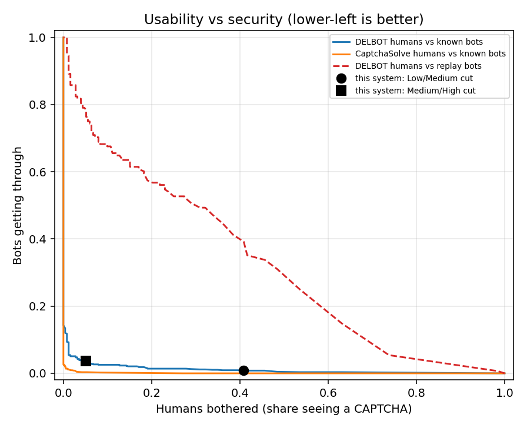

# Risk model report
_generated 2026-11-08 16:00_


## Data
```
train: 8482 windows
val: 2847 windows
test: 2983 windows
```

## Model comparison (test split, group-disjoint)
```
        model                set    auc     ap  tpr@fpr1%  tpr@fpr5%    n
       logreg        delbot_only 0.9691 0.9891     0.7892     0.8765  916
       logreg in_domain_all_bots 0.9747 0.9929     0.8046     0.8960 1117
random_forest        delbot_only 0.9901 0.9967     0.9292     0.9654  916
random_forest in_domain_all_bots 0.9924 0.9980     0.9445     0.9734 1117
      hist_gb        delbot_only 0.9921 0.9972     0.9247     0.9563  916
      hist_gb in_domain_all_bots 0.9938 0.9983     0.9399     0.9653 1117
```

## Source-leakage check (humans only: DELBOT vs CaptchaSolve30k)
AUC = **1.000** - HIGH - features strongly encode which dataset a human came from; mixing sources as human/bot classes would be confounded. Keep DELBOT as the only labelled-class source.
Most source-revealing features:
```
stationary_frac    0.227
x_range            0.141
pauses_per_s       0.108
turn_std           0.085
v_cv               0.075
jerk_std_log       0.056
```

## Leave-one-bot-type-out (bot family never seen in training)
`not_low` = share that would get at least a CAPTCHA; `high` = share that would get the strongest tier.
```
             held_out_bot_type   n  not_low  high
               circles_bot_gan 380    1.000 0.168
circles_bot_naturalmousemotion 132    0.962 0.015
              circles_bot_pyhm  12    0.750 0.083
            circles_bot_pynput 140    0.429 0.307
                    syn_bezier  57    1.000 0.228
                     syn_naive  30    1.000 1.000
               syn_naive_dense  57    1.000 0.895
              syn_noisy_bezier  57    1.000 0.754
```

## Final model: random_forest, trained on 'mixed', sigmoid-calibrated
Thresholds from held-out human scores: LOW < 0.020 <= MEDIUM < 0.525 <= HIGH

### Usability cost - where do held-out HUMANS land?
```
tier       low  medium   high     n
g                                  
capycap  0.980   0.020  0.000  1718
delbot   0.591   0.357  0.052   252
```
`capycap` rows are out-of-distribution humans (different task/device): high medium/high shares there mean the model would annoy real users whose behaviour differs from DELBOT's collection.

### Security - where do held-out BOTS land? (`syn_replay` was never trained on)
```
tier                              low  medium   high    n
g                                                        
circles_bot_gan                 0.000   0.000  1.000  380
circles_bot_naturalmousemotion  0.045   0.068  0.886  132
circles_bot_pyhm                0.000   0.250  0.750   12
circles_bot_pynput              0.014   0.086  0.900  140
syn_bezier                      0.000   0.000  1.000   57
syn_naive                       0.000   0.000  1.000   30
syn_naive_dense                 0.000   0.000  1.000   57
syn_noisy_bezier                0.000   0.000  1.000   57
syn_replay                      0.392   0.399  0.209  148
```

## Trade-off curve
Each point on a curve is one threshold: right = more humans bothered, up = more bots getting through. Black markers are this system's two cut-offs.


